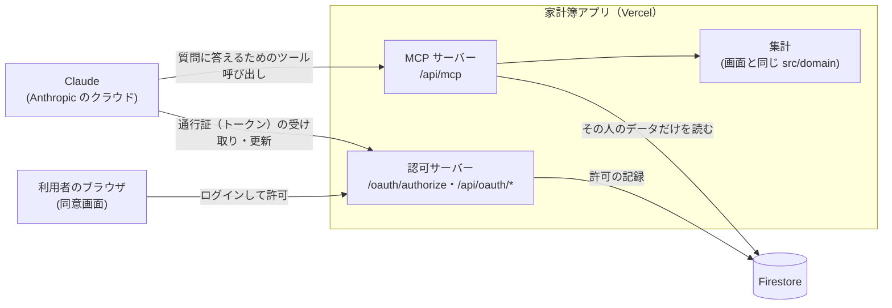

# Claude 連携のしくみ（概要）

家計簿を claude.ai（Web・デスクトップ・スマホ）のチャットから読み取れるようにする機能の、全体像をまとめる。細かい決まりと設計の理由は[仕様書](./仕様書.md)、作り方・運用・つまずいた点は[手順書](./手順書.md)にある。この文書の内容は v6.11.2 の時点のものである。

## 1. 何ができるか

claude.ai に家計簿を「カスタムコネクタ」として登録すると、チャットで次のような依頼ができる。

- 「先月の食費は？」「今年の支出を月ごとに表にして」（集計）
- 「先月のコンビニの支出を全部出して」（検索）
- 「ここ半年の支出を見て、見直せそうな項目を挙げて」（改善案）

家計簿の側は読み取り専用で、取引や設定を変えることはできない。集計はアプリの画面と同じ関数で行うので、Claude が答える数字は画面の数字と一致する。改善案の文章を考えるのは Claude である。

## 2. 全体の構成

家計簿アプリ（Next.js、Vercel）の中に、二つのサーバーの役割を足している。一つは Claude からの質問に答える **MCP サーバー**、もう一つは Claude に「この人の家計簿を読んでよい」という許可を渡す **認可サーバー**（OAuth）である。どちらも同じアプリの API（Route Handler）として動き、別のサーバーは無い。

Claude からの通信は、利用者の端末ではなく Anthropic のクラウドから来る。スマホのアプリで使っても同じなので、MCP サーバーはインターネットから届く本番の URL に置いている。

## 3. 質問してから答えが返るまで

1. 利用者がチャットで「先月の収支は？」と聞く。
2. Claude は、家計簿が公開している6つの**ツール**（関数）の説明を読み、`get_monthly_summary` を `month: "2026-09"` で呼ぶと決める。
3. Claude が `/api/mcp` を呼ぶ。このとき**アクセストークン**（1時間有効の通行証）を付ける。
4. MCP サーバーがトークンを確かめる。署名・宛先・期限が正しく、持ち主が許可リスト（`MCP_ALLOWED_UIDS`）に入っていれば、その人の uid が分かる。
5. ツールが、その uid の取引のうち必要な期間（この例では前月と当月）だけを Firestore から読む。
6. 画面と同じ集計関数で、収入・支出・収支・カテゴリ別などを計算し、JSON で返す。
7. Claude がその数字をもとに答えの文章を書く。

ツールは次の6つで、Claude は最初に「概要」を呼んでカテゴリの名前や役割を確かめてから、ほかのツールを使う。

| ツール | 内容 |
|--------|------|
| `get_kakeibo_overview` | 今日の日付、記録のある期間、カテゴリと役割、予算、支払方法 |
| `search_transactions` | 条件に合う取引の一覧と合計（期間は最長366日） |
| `get_monthly_summary` | 1か月の収支・前月比・カテゴリ別・予算との比較 |
| `get_trend` | 複数の月の推移（最長36か月） |
| `get_annual_review` | 1年の振り返り（貯蓄率・前年比・額面年収の推定） |
| `list_recurring_transactions` | 定期取引の一覧と、今月記録したか |

## 4. 最初につなぐとき

Claude にパスワードを渡さずに読み取りの許可だけを渡すため、OAuth という仕組みを使う。

1. 利用者が claude.ai にコネクタ（URL と Client ID）を登録して「接続」を押す。
2. ブラウザで家計簿の**同意画面**が開く。家計簿にログインして「許可する」を押す。最後のログインから時間がたっていれば、パスワードをもう一度聞かれる（5分以内のログインが必要）。
3. 家計簿が claude.ai に一度きりの**認可コード**（5分有効）を渡し、Claude がそれを**アクセストークン**（1時間）と**リフレッシュトークン**（更新用。30日）に交換する。
4. 以後は、アクセストークンが切れるたびに Claude がリフレッシュトークンで新しいものを受け取る。利用者がログインし直す必要は無い。使い続ける限り接続は続き、30日使わなければ切れる。

同意の確認に家計簿のログイン（Firebase のメール/パスワード）をそのまま使うので、Claude 連携のための別のアカウントは要らない。

## 5. 他人のデータが見えない理由

アプリの画面は、Firestore のセキュリティルール（`firestore.rules`）で他人のデータを読めないようにしている。Claude 連携のサーバーは、ルールを通らない管理用のライブラリ（Admin SDK）で Firestore を読むので、代わりに次の決まりで守っている。

- **読む相手はトークンだけで決まる**: uid は検証したアクセストークンから取り出し、ツールの入力からは受け取らない。Claude に「別の人の家計簿を見せて」と頼まれても、指定する手段が無い。
- **読み出しは1か所に集める**: Firestore を読むのは `src/server/kakeiboReader.ts` の関数だけで、どれも最初に uid で絞り、読んだ結果の持ち主ももう一度確かめる。エミュレータのテストで、別の利用者の取引が混ざらないことを確かめている。
- **使える人を限る**: 許可リストに無いアカウントは、同意のときも、ツールを呼ぶたびにも拒否する。
- **許可は本人が直前に行う**: 同意には5分以内のログインを求めるので、ログインしたままの端末を他人が触っても接続は作れない。
- **パスワードを変えれば切れる**: 接続を作った後にパスワードの変更・再設定やアカウントの無効化があれば、次の更新（最長1時間後）でその接続を消す。
- **読み取り専用**: 書き込みのツールは無い。
- **そのほか**: 通行証は署名付きで1時間で切れる。不正な形のコードやトークンは Firestore を読む前に拒否する。呼び出しの回数は Vercel Firewall で制限する（コードではなく Vercel の画面での設定。手順書 2.8 節）。プレビュー環境では機能ごと無効にしている。

## 6. コードの置き場所

| 場所 | 中身 |
|------|------|
| `src/app/api/mcp/route.ts` | MCP サーバーの入り口 |
| `src/app/oauth/authorize/page.tsx`・`src/app/api/oauth/*` | 同意画面とトークンの発行・接続の確認と解除 |
| `src/app/.well-known/*` | Claude が接続方法を見つけるための案内（メタデータ） |
| `src/server/mcp/` | MCP サーバーの設定（`handler.ts`）、ツールの定義（`tools.ts`）と結果の組み立て（`summaries.ts`） |
| `src/server/oauth/` | 認可サーバーの部品（コード・トークン・検証・掃除） |
| `src/server/kakeiboReader.ts` | uid で絞った Firestore の読み出し |
| `src/features/claude-connect/` | 同意画面と、設定画面の「Claude との接続」欄 |
| `firestore.indexes.json` | 必要な複合インデックス |

`src/server/` はサーバー専用で、画面のコードからは読み込めないように ESLint で検査している。

## 7. 使う人を増やすには

各自が自分のアカウントで、自分の家計簿だけを読む。

1. その人に家計簿アプリのアカウントを作ってもらう（ログイン画面の「新規登録」）。
2. Firebase Console →「Authentication」→「ユーザー」で、その人の「ユーザー UID」を控える。
3. Vercel の Environment Variables（Production）で `MCP_ALLOWED_UIDS` にカンマでつなげて足し、「Deployments」から本番を再デプロイ（Redeploy）する。
4. その人の claude.ai にコネクタを追加してもらう。URL は `https://<家計簿のドメイン>/api/mcp`、Client ID は `MCP_OAUTH_CLIENT_ID` の値（秘密の値ではない）、Client Secret は空。同意画面では、その人自身のアカウントでログインする。

ほかの人に**自分の**家計簿を見てもらう機能（家族での共有など）は無い。作るなら、他人のデータを読まないという前提を変えることになるので、仕様から決め直す。

## 8. Firestore の読み取り量の目安

Firestore は、読んだドキュメント1件ごとに読み取り1回と数える。ツールは必要な期間だけを読むので、量は「期間 × 月あたりの取引件数」で決まる。月に100件記録している場合の目安は次のとおり。

| 操作 | 1回あたり |
|------|-----------|
| 概要 | 約3件 |
| 月の収支 | 約200件（前月と当月） |
| 検索（既定の約3か月） | 約300件 |
| 推移（既定の12か月） | 約1,200件 |
| 年間の振り返り | 約2,400件（前年と当年） |
| 通行証の更新（使っている間だけ、1時間に1回ほど） | 数件 |

Claude は質問1つでツールを2〜5回ほど呼ぶので、1回の会話で数百〜5,000件ほどになる。無料プラン（Spark）の上限は1日5万件で、日に数回の会話なら収まる。比べると、アプリを1回起動すると直近13か月分（約1,300件）を読む。実際の量は Firebase Console →「Firestore Database」→「使用状況」で日ごとに見られる。

## 9. 止める・解除する

| したいこと | 方法 |
|------------|------|
| 自分の接続を切る | 家計簿の「設定」→「Claude との接続」で解除し、claude.ai のコネクタも削除する。最長1時間は、Claude がすでに受け取った通行証で読めることがある |
| パスワードが漏れたかもしれない | パスワードを変える。それより前に作った接続は1時間ほどで切れる |
| ある人に使わせない | `MCP_ALLOWED_UIDS` から外して再デプロイする |
| 機能全体を止める | Vercel の `MCP_ENABLED` を消して再デプロイする（すべての入り口が 404 になる） |

## 10. 詳しい資料

| 知りたいこと | 場所 |
|--------------|------|
| 用語・構成図 | 仕様書 3章 |
| 設計の選択（なぜ自前の認可サーバーか など） | 仕様書 4章 |
| 接続の流れ・トークン・解除の細かい決まり | 仕様書 5章 |
| ツールの入出力 | 仕様書 6章 |
| データの読み方・タイムゾーン・インデックス | 仕様書 7章 |
| セキュリティの点検項目・環境変数 | 仕様書 8・9章 |
| 準備（サービスアカウント・環境変数・インデックス・レート制限） | 手順書 2章 |
| claude.ai への登録と確認 | 手順書 6章 |
| 運用・うまくいかないとき | 手順書 8・9章 |
| 実装でつまずいた点と教訓 | 手順書 10章 |
| Claude からの記録と編集（計画中） | [書き込み仕様書](./書き込み仕様書.md)・[書き込み手順書](./書き込み手順書.md) |
