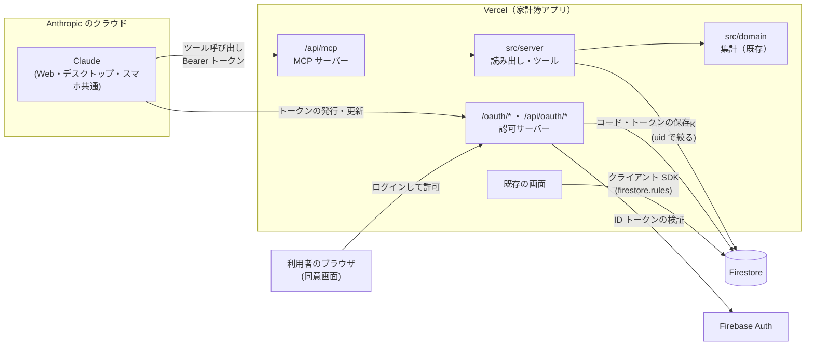
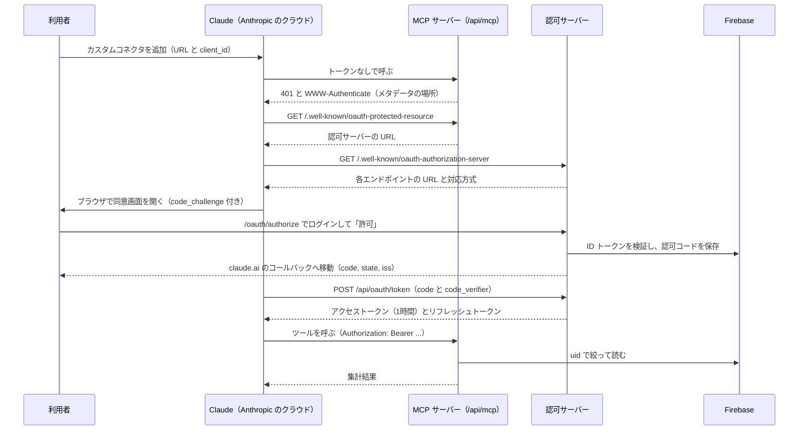

# Claude 連携（リモート MCP サーバー）仕様書

- 状態: v1 を実装（読み取り専用ツール・認可サーバーは v6.7.0、設定画面での接続の解除は v6.8.0）
- 作成: 2026-10-22
- 実装の手順: [手順書.md](./手順書.md)

## 1. この文書の目的と範囲

この文書は、Claude のチャットから家計簿のデータを検索・集計できるようにする機能（以下「Claude 連携」）の仕様を定める。仕様書には「何をどう振る舞わせるか」と「なぜその設計にしたか」を書き、「どの順に何を作り、どう確かめるか」は手順書に分けた。

外部の仕様は 2026年10月時点で確認したものに基づく。MCP の認可仕様は 2026-07-28 版を参照した。Claude のカスタムコネクタは、公式の資料によれば 2025-03-26・2025-06-18・2025-11-25 版の認可仕様に従う。MCP サーバーのライブラリ mcp-handler は 2.x を前提とする。どれも改定が多いので、実装を始める前に 13章の資料を読み直す。

## 2. 何ができるようになるか

利用者は claude.ai（Web・デスクトップアプリ・スマホアプリ）のチャットで、次のような依頼ができるようになる。

- 「先月のコンビニの支出を全部出して」（検索）
- 「今年の食費を月ごとに並べて、去年と比べて」（集計）
- 「ここ半年の支出を見て、削れそうなところを3つ挙げて」（改善案）

Claude は依頼を受けると、家計簿が公開するツール（検索や集計を行う関数）を呼び、返ってきた数値をもとに回答する。改善案の文章を考えるのは Claude で、家計簿の側は正確な数値を返す役割に徹する。

### 2.1 最初の版（v1）の範囲

- 読み取りだけを提供する。取引の追加・編集・削除はできない。
- 接続できるのは、許可リストに載せた Firebase のアカウント（本人と家族を想定）だけである。
- 対応するクライアントは claude.ai のカスタムコネクタ（Web・デスクトップ・スマホ）。Claude Code からの接続は対象外とする（12章）。

書き込みを後回しにする理由は二つある。誤った取引が作られたときの影響が読み取りより大きいこと。そして読み取り専用のツールなら、claude.ai が呼ぶたびに利用者の確認を求めないので、使い勝手を確かめやすいこと。

## 3. 全体像

### 3.1 用語

| 用語 | 意味 |
|------|------|
| MCP | Model Context Protocol。Claude などの AI アプリが、外部のツールやデータを呼ぶための通信の取り決め |
| MCP サーバー | ツールを公開する側。この機能では家計簿アプリ（Next.js）の中に作る |
| ツール | MCP サーバーが公開する関数。名前・説明・入力の型を持ち、Claude が必要に応じて呼ぶ |
| カスタムコネクタ | claude.ai に、自分で MCP サーバーの URL を登録する機能 |
| OAuth 2.1 | パスワードを渡さずに、他のアプリ（ここでは Claude）へアクセス権だけを与える仕組み |
| 認可サーバー | OAuth で利用者の同意を取り、トークンを発行する側。この機能では家計簿アプリの中に作る |
| アクセストークン | Claude が MCP サーバーを呼ぶたびに付ける、期限付きの証明。1時間で切れる |
| リフレッシュトークン | アクセストークンが切れたとき、利用者のログインなしで新しいものを受け取るための値 |
| PKCE | 認可コードを横取りされても使えないようにする仕組み。Claude が秘密の値を作り、そのハッシュを先に認可サーバーへ送っておく |
| Admin SDK | Firebase のサーバー用ライブラリ（firebase-admin）。セキュリティルールを通らずに読み書きできる |

### 3.2 構成



Claude からの通信は、利用者の端末ではなく Anthropic のクラウドから届く。スマホのアプリで使っても同じなので、MCP サーバーはインターネットから届く URL（Vercel の本番ドメイン）に置く。

### 3.3 今の構成から変わること

今のアプリはブラウザが Firestore を直接読み書きし、他人のデータへのアクセスを止めているのは `firestore.rules` だけである。Claude 連携では、この前提が二つの点で変わる。

一つ目は、サーバー側で動くコードが初めて加わること。Next.js の Route Handler（`src/app/**/route.ts`）として、MCP の受け口と OAuth のエンドポイントを置く。Vercel の上で動くので、別のサーバーを用意する必要はない。

二つ目は、セキュリティルールを通らない読み出しが加わること。サーバーは利用者としてログインしているわけではないので、Admin SDK で Firestore を読む。Admin SDK はルールを無視するため、「その利用者の取引だけを読む」ことはサーバーのコードで保証することになる。保証の方法は 7.2 節で定める。

既存の画面・Context・クライアントからの読み書きは変えない。

## 4. 設計の選択

### 4.1 認証の方式

claude.ai のカスタムコネクタが使える認証は、OAuth・認証なし・固定のヘッダー（一部の組織だけのベータ）の三つである。家計データを認証なしで公開するわけにはいかないので、OAuth を使う。

OAuth の認可サーバーについては、次の二案を比べた。

| 案 | 内容 | 長所 | 短所 |
|----|------|------|------|
| A. 外部の認証サービス | Clerk・Auth0 などに認可サーバーを任せ、そのアカウントを Firebase の uid に対応づける | OAuth のエンドポイントを自分で書かずに済む | アカウントの仕組みが Firebase と二重になる。外部サービスの契約と設定が増える |
| B. 自前の認可サーバー | 家計簿アプリの中に認可サーバーを作り、ログインには今の Firebase のメール/パスワードを使う | ログインが一つのまま。外部サービスが増えない | OAuth のエンドポイントを自分で書き、安全に保つ責任を負う |

この仕様では B を採る。家計簿のログインは Firebase に一本化されており、Claude 連携のためだけに別のアカウントを作って対応づけるのは、利用者にとっても運用にとっても負担が大きい。B の短所である実装の難しさは、受け付けるクライアントを Claude だけに限ることで小さくできる。具体的には、リダイレクト先を Claude のコールバック URL 1つに固定し、クライアントの登録を事前登録の1件だけにする（5.4 節）。誰でもクライアントを登録できる認可サーバーに比べ、検証する入力の幅がずっと狭い。

### 4.2 MCP サーバーの置き場所

MCP サーバーは、今の Next.js アプリの Route Handler として作る。別のサーバーに分けると、デプロイ先・環境変数・集計のコードをもう一組管理することになる。同じアプリに置けば `src/domain/` の集計関数をそのまま呼べるので、Claude に返す数値と画面の数値が同じ計算から出る。

ライブラリには Vercel の mcp-handler（2.x）を使う。MCP の通信（Streamable HTTP）、トークンの確認（`withMcpAuth`）、保護リソースのメタデータ（`protectedResourceHandler`）を提供している。2.x はセッションを持たない（stateless）ので、呼び出しごとに関数が起動し直す Vercel の環境でも、Redis などの保存先を足す必要がない。

### 4.3 集計をどこで行うか

集計はサーバー側で済ませ、Claude には結果だけを返す。取引を丸ごと渡して Claude に足し算させる方式は採らない。理由は三つある。

1. 投資・立替金の除外やカテゴリの改名の読み替えなど、このアプリの集計規則（役割による判定）を、Claude が毎回正しく再現できる保証がない。
2. claude.ai では、ツールの結果1回あたり約15万文字という上限がある。数年分の取引はこれを超えうる。
3. 渡す量が多いほど応答が遅くなり、会話の中で使える量も減る。

検索のツールは取引の一覧を返すが、件数に上限を設け（6.3 節）、合計額はサーバーが計算して添える。

## 5. 認証と認可

### 5.1 接続の流れ

初めてコネクタをつなぐときの流れを示す。



つないだ後は、Claude がアクセストークンを付けて MCP サーバーを呼ぶ。Claude は 401 を受けたとき、または保存している期限の5分前になると、リフレッシュトークンで新しいトークンを取り直す。そのため利用者がログインし直す必要はない。

### 5.2 エンドポイント

表の `{origin}` は本番の URL（例 `https://kakeibo.example.com`）で、環境変数 `MCP_PUBLIC_ORIGIN` から取る。リクエストの Host ヘッダーから組み立てると、偽の Host を送られたときに別のドメインを指すメタデータを返してしまうので、使わない。

| パス | メソッド | 役割 | ファイル |
|------|----------|------|----------|
| `/api/mcp` | POST（GET） | MCP の受け口。トークン必須 | `src/app/api/mcp/route.ts` |
| `/.well-known/oauth-protected-resource` | GET, OPTIONS | 保護リソースのメタデータ（RFC 9728） | `src/app/.well-known/oauth-protected-resource/route.ts` |
| `/.well-known/oauth-authorization-server` | GET, OPTIONS | 認可サーバーのメタデータ（RFC 8414） | `src/app/.well-known/oauth-authorization-server/route.ts` |
| `/oauth/authorize` | GET（画面） | 同意画面 | `src/app/oauth/authorize/page.tsx` |
| `/api/oauth/authorize` | POST | 同意の結果を受け取り、認可コードを発行する | `src/app/api/oauth/authorize/route.ts` |
| `/api/oauth/token` | POST | トークンの発行と更新 | `src/app/api/oauth/token/route.ts` |
| `/api/oauth/connections` | GET, DELETE | 接続状態の確認と解除（設定画面から使う） | `src/app/api/oauth/connections/route.ts` |

同意画面は既存のタブ（`(tabs)` グループ）の外に置き、ヘッダーやタブバーを出さない。Route Handler はすべて Node.js のランタイムで動かす（Admin SDK が Edge ランタイムでは動かないため）。

### 5.3 メタデータ

保護リソースのメタデータは、MCP サーバーがどの認可サーバーを使うかを Claude に知らせる。mcp-handler の `protectedResourceHandler` が返す。

```json
{
  "resource": "{origin}/api/mcp",
  "authorization_servers": ["{origin}"]
}
```

認可サーバーのメタデータは自前で返す。

```json
{
  "issuer": "{origin}",
  "authorization_endpoint": "{origin}/oauth/authorize",
  "token_endpoint": "{origin}/api/oauth/token",
  "response_types_supported": ["code"],
  "grant_types_supported": ["authorization_code", "refresh_token"],
  "code_challenge_methods_supported": ["S256"],
  "token_endpoint_auth_methods_supported": ["none"],
  "scopes_supported": ["kakeibo.read"],
  "authorization_response_iss_parameter_supported": true
}
```

`issuer` は末尾のスラッシュを付けず、メタデータの URL を組み立てた元の値と完全に一致させる。MCP の仕様では、一致しないメタデータをクライアントは使わない。`code_challenge_methods_supported` を省くと PKCE に対応していないとみなされ、接続がそこで止まる。`registration_endpoint` と `client_id_metadata_document_supported` は、v1 では載せない（5.4 節）。

### 5.4 クライアントの登録

OAuth では、トークンを求めるアプリ（ここでは Claude）を、認可サーバーがあらかじめ知っておく必要がある。登録の方法は三つあり、Claude はどれにも対応している。

| 方法 | 内容 | v1 |
|------|------|----|
| 事前登録 | 認可サーバー側で決めた client_id を、利用者が Claude の画面に入力する | 採用 |
| CIMD（Client ID Metadata Document） | Claude が公開しているクライアント情報の URL を client_id として使う | 採用しない |
| 動的登録（DCR） | Claude が認可サーバーに自分を登録する | 採用しない |

事前登録を採るのは、登録するクライアントが Claude の1件で済むからである。DCR を開くと誰でもクライアントを登録できるので、登録内容の検証と保存、溜まった登録の掃除が要る。CIMD では認可サーバーが外部の URL を取得して検証するので、取得先を攻撃者に指定されたときの対策（SSRF 対策）が要る。どちらも Claude 1件のためには手間が見合わない。なお MCP の 2026-07-28 版の仕様では、DCR は非推奨になり CIMD が推奨されている。将来 CIMD に対応する場合は 12章に書いた。

事前登録のクライアントは次のとおりとする。

- client_id: 環境変数 `MCP_OAUTH_CLIENT_ID`（推測されにくい文字列。例 `kakeibo-claude-3f9c1a…`）
- 種類: 公開クライアント（client secret を持たない。`token_endpoint_auth_method` は `none`）。PKCE で保護する
- redirect_uri: `https://claude.ai/api/mcp/auth_callback` の1件だけ。完全一致で比べる

公開クライアントの client_id は秘密ではない。漏れても PKCE と同意画面があるので、それだけではトークンを取れない。それでも推測されにくい値にしておけば、無関係な人が同意画面までたどり着く機会を減らせる。

Claude 側では、コネクタを追加するときに「自分の OAuth クライアントを使う」（Use your own OAuth client）を選び、client ID にこの値を入れ、secret は空のままにする（手順書 6章）。

### 5.5 認可リクエストと同意画面

Claude は利用者のブラウザで次の形の URL を開く。

```
{origin}/oauth/authorize?response_type=code&client_id=...&redirect_uri=...
  &code_challenge=...&code_challenge_method=S256&state=...&scope=...&resource=...
```

同意画面のページ（サーバーコンポーネント）は、画面を出す前にサーバー側でパラメータを検証する。

| 項目 | 条件 | 満たさないとき |
|------|------|----------------|
| client_id | `MCP_OAUTH_CLIENT_ID` と一致 | エラー画面を出す（リダイレクトしない） |
| redirect_uri | 許可リストと完全一致 | エラー画面を出す（リダイレクトしない） |
| response_type | `code` | redirect_uri へ `error=unsupported_response_type` |
| code_challenge_method | `S256` | `error=invalid_request` |
| code_challenge | base64url で43文字 | `error=invalid_request` |
| scope | 省略時は `kakeibo.read`。それ以外を含めば拒否 | `error=invalid_scope` |
| resource | 省略時は `{origin}/api/mcp`。指定されたらこれと完全一致 | `error=invalid_target` |
| state | そのまま返す（無くても受け付ける） | — |

client_id と redirect_uri が不正なときにリダイレクトしないのは、OAuth の決まりである。不正な redirect_uri へエラーを返してしまうと、攻撃者が用意した URL へ利用者を送り込む踏み台になる。

検証を通れば同意画面を出す。画面には次を表示する。

- 「Claude が家計簿のデータを読み取ろうとしています」という説明と、許可する範囲（取引・設定・定期取引の読み取り。変更はできない）
- 移動先のホスト名（claude.ai）。MCP の仕様が表示を求めている
- ログイン中のメールアドレス。別のアカウントで許可してしまう事故を防ぐ
- 「許可する」「キャンセル」のボタン

ログインしていなければ、既存のログインフォーム（`@/features/auth`）を出し、ログインした後に同意画面へ進む。

「許可する」を押すと、画面は Firebase の ID トークン（`auth.currentUser.getIdToken()`）とパラメータを `POST /api/oauth/authorize` に送る。サーバーは次の順に処理する。

1. パラメータを同じ規則でもう一度検証する。画面での検証は表示のためのもので、サーバーはそれを信用しない。
2. ID トークンを検証し、uid を得る。Firebase が公開している手順（第三者の JWT ライブラリでの検証）どおりに、`jose` で RS256 の署名（Google の公開鍵）・aud（プロジェクト ID）・iss・exp・iat・auth_time・sub を確かめる（`src/server/oauth/firebaseIdToken.ts`）。Admin SDK の `verifyIdToken` は使わない。依存する部品（`jwks-rsa`）が Vercel の Node.js では読み込めず、500 になったため（v6.7.2）。そのため失効（revoke）の確認はしないが、ID トークンの寿命は1時間で、同意はその時点でログインしている本人がボタンを押したときだけ行う。
3. uid が許可リスト（`MCP_ALLOWED_UIDS`）にあるかを確かめる。無ければ `error=access_denied` とする。
4. 認可コードを発行して保存する（5.6 節）。
5. `{redirect_uri}?code=...&state=...&iss={origin}` を応答として返す。

画面はこの URL へ `location.assign` で移動する。HTML のフォーム送信とサーバーからのリダイレクト（302）にしないのは、CSP の `form-action 'self'` がフォーム送信の後のリダイレクト先にも適用され、claude.ai への移動が止められうるからである。今の CSP は Report-Only なので止まらないが、強制モードに切り替えたときに壊れないようにしておく。

「キャンセル」なら `{redirect_uri}?error=access_denied&state=...&iss={origin}` へ移動する。

ID トークンを Cookie ではなくリクエストの本文で送るので、別のサイトが利用者に気づかれないようにこの API を呼ばせる攻撃（CSRF）は成り立たない。同意画面を別のサイトの iframe に埋め込んでボタンを押させる攻撃（クリックジャッキング）は、既存のセキュリティヘッダー（`X-Frame-Options: DENY` と CSP の `frame-ancestors 'none'`）が防ぐ。

### 5.6 認可コード

- 値: 32バイトの乱数を base64url にしたもの
- 保存先: Firestore の `oauthAuthorizationCodes/{sha256(code)}`。値そのものではなくハッシュを ID にするので、データベースの中身を見られてもコードとしては使えない
- 中身: uid、clientId、redirectUri、codeChallenge、scope、resource、expiresAt（発行から5分）、createdAt
- 1回しか使えない。トークンと交換するときに、Firestore のトランザクションの中で読み出しと削除を同時に行う

### 5.7 トークンの発行（POST /api/oauth/token）

リクエストの本文は `application/x-www-form-urlencoded` で受け取る。応答には `Cache-Control: no-store` を付ける。

初回（`grant_type=authorization_code`）では、code・redirect_uri・client_id・code_verifier・resource（任意）を受け取り、次を検証する。

1. code のハッシュでコードを引き、トランザクションの中で読み出しと削除を行う。無ければ `invalid_grant`。
2. 期限が切れていれば `invalid_grant`。
3. client_id と redirect_uri が、コードに保存した値と一致すること。
4. `base64url(sha256(code_verifier))` が codeChallenge と一致すること（PKCE）。
5. resource が指定されていれば、保存した値と一致すること。

すべて通れば、5.8 節のアクセストークンと 5.9 節のリフレッシュトークンを発行する。更新（`grant_type=refresh_token`）の処理は 5.9 節で定める。

エラーは RFC 6749 の形式（HTTP 400 と `{"error": "invalid_grant", "error_description": "..."}`）で返す。`error_description` に uid や Firestore のエラー内容など、内部の事情を書かない。

### 5.8 アクセストークン

アクセストークンは署名付きの JWT（HS256。鍵は `MCP_TOKEN_SECRET`）にする。保存せずに署名だけで検証できるので、ツールを呼ぶたびに Firestore を読まずに済む。

| クレーム | 値 |
|----------|----|
| iss | `{origin}` |
| sub | Firebase の uid |
| aud | `{origin}/api/mcp` |
| scope | `kakeibo.read` |
| client_id | `MCP_OAUTH_CLIENT_ID` |
| iat / exp | 発行時刻 / 発行から1時間後 |
| jti | 乱数 |

応答は次の形になる。

```json
{
  "access_token": "eyJ...",
  "token_type": "Bearer",
  "expires_in": 3600,
  "refresh_token": "...",
  "scope": "kakeibo.read"
}
```

JWT には発行した後で個別に無効にする仕組みが無いので、有効期限を1時間と短くする。接続を解除したときにどこまで効くかは 5.10 節にまとめた。

### 5.9 リフレッシュトークン

- 値: 32バイトの乱数（base64url）
- 保存先: `oauthRefreshTokens/{sha256(token)}`
- 中身: uid、clientId、scope、familyId、expiresAt（発行から30日）、usedAt（未使用なら null）、createdAt
- familyId: 最初の認可のときに作る ID。更新で発行し直したトークンも同じ familyId を引き継ぐ

更新（`grant_type=refresh_token`）では、refresh_token・client_id・resource（任意）・scope（任意）を受け取り、トランザクションの中で次を行う。

1. ハッシュで引く。無ければ `invalid_grant`。
2. 期限が切れていれば `invalid_grant`。
3. client_id が一致しなければ `invalid_grant`。
4. usedAt が入っていれば、使用済みのトークンがもう一度使われたことになる。盗まれたトークンが使われた可能性があるので、同じ familyId のトークンをすべて削除して `invalid_grant` を返す。ただし usedAt から60秒以内の再使用なら、削除はせず `invalid_grant` だけを返す。Claude が同時に2回更新を送った場合に、接続そのものが切れないようにするためである。
5. usedAt を記録し、新しいアクセストークンと、同じ familyId の新しいリフレッシュトークンを返す。

使うたびに新しいリフレッシュトークンへ替える方式（ローテーション）は、公開クライアントに対して MCP の仕様と OAuth 2.1 が求めている。古いトークンは、新しいトークンを返すのと同じ処理の中で使用済みになる。

30日間一度も使われなければリフレッシュトークンは切れ、Claude の画面でつなぎ直すことになる。

使用済みのリフレッシュトークンは、使った時点で期限を24時間後に縮める（元の期限のほうが早ければそのまま）。更新は1時間ごとに起きるので、30日の期限まで残すと1つの接続で数百件が溜まるためである。再使用の検出（手順 4）が働くのはこの24時間のあいだで、それより後の再使用は「知らないトークン」として `invalid_grant` になる（接続ごとの削除はしない）。

期限の切れたコードとトークンのドキュメントは、トークンを発行するたびに `deleteExpired`（`src/server/oauth/store.ts`）で消す。当初は Firestore の TTL ポリシーで消す予定だったが、TTL は無料プランでは使えないため、アプリの側で消すことにした（v6.8.0）。1回に消すのはコレクションごとに200件までで、残りは次の発行のときに消える。消すのは発行のついでなので、コードの側でも必ず expiresAt を確かめる。

### 5.10 利用の停止と接続の解除

| 場面 | 方法 | 効くまでの時間 |
|------|------|----------------|
| ある利用者の接続を切る | 設定画面の「接続を解除」で、その uid のリフレッシュトークンをすべて削除する | 最長1時間（手元のアクセストークンが切れるまで） |
| ある利用者に使わせない | `MCP_ALLOWED_UIDS` から外して再デプロイする | 即時（トークンを確かめるたびに許可リストを見るため） |
| 機能全体を止める | `MCP_ENABLED` を `1` 以外にして再デプロイする | 即時（すべてのエンドポイントが 404 を返す） |
| 署名鍵の漏えいが疑われる | `MCP_TOKEN_SECRET` を替えて再デプロイし、`oauthRefreshTokens` を全件削除する | 即時。全員がつなぎ直す |

Claude の側でコネクタを削除しても、家計簿の側のリフレッシュトークンは残る。v1 には Claude から失効の通知を受け取る仕組みが無いためで、気になる場合は家計簿の設定画面でも接続を解除する。

設定画面には「Claude との接続」の欄を置き、接続中かどうか（有効なリフレッシュトークンがあるか）と「接続を解除」のボタンを出す。画面は ID トークンを `Authorization: Bearer` に付けて `GET /api/oauth/connections`（状態）と `DELETE /api/oauth/connections`（解除）を呼ぶ。

### 5.11 MCP サーバーでのトークンの確認

`withMcpAuth` に渡す確認関数は、次の順に確かめる。

1. JWT の署名・iss・aud・exp を検証する（`jose` の `jwtVerify`。algorithms には `HS256` だけを許す）。aud を確かめるのは、別の用途で発行されたトークンを受け付けないためで、MCP の仕様が求めている。
2. scope に `kakeibo.read` を含むこと（`withMcpAuth` の `requiredScopes`）。
3. sub（uid）が許可リストにあること。
4. 通れば `{ token, clientId, scopes, expiresAt, extra: { uid } }` を返す。ツールは `ctx.http?.authInfo` の `extra.uid` から uid を得る。

失敗すれば、mcp-handler が 401 と `WWW-Authenticate: Bearer resource_metadata="{origin}/.well-known/oauth-protected-resource"` を返す。トークンは `Authorization` ヘッダーでだけ受け付け、URL のクエリでは受け付けない。

## 6. ツール

### 6.1 すべてのツールに共通する決まり

- すべて読み取り専用とし、各ツールに `title` と `annotations: { readOnlyHint: true }` を付ける。claude.ai はこの印を見て、呼ぶたびの確認を省く。
- 対象の利用者はトークンの uid で決まる。ツールの入力に uid や userId を持たせない。
- カテゴリ名は今の名前で返し、入力でも今の名前で受け付ける。改名前の名前で記録された取引は、`rules.categoryName(t)` で今の名前に読み替える（#97）。
- 集計の規則は画面と同じにする。投資・立替金・`affectsExpense = false` の取引を支出から除く判定は `createTransactionRules` が作る関数で行い、集計には `src/domain/` の関数を呼ぶ。ツールの中に独自の集計規則を書かない。
- 金額は円の整数、日付は日本時間の `YYYY-MM-DD`、月は `YYYY-MM` で表す。
- 結果は JSON を文字列にして text で返す（`content: [{ type: 'text', text: JSON.stringify(result) }]`）。キー名は英語の camelCase、ツールの説明文は日本語で書く。
- 入力は zod で検証し、範囲外の値はエラーにする。黙って丸めると、Claude が意図と違う条件の結果を正しいものとして扱ってしまう。
- エラーのときは `isError: true` と、利用者に見せてよい短い説明を返す。取引の中身や内部のエラーの詳細は含めない。
- 1回の結果は約15万文字（claude.ai の上限）より十分小さく保つ。超えそうなら件数を減らし、`truncated: true` を付ける。

### 6.2 get_kakeibo_overview

Claude が最初に呼び、家計簿の全体像（記録のある期間・カテゴリ・役割）をつかむためのツール。入力は無い。

```json
{
  "today": "2026-10-22",
  "recordedPeriod": { "first": "2021-04-01", "last": "2026-10-21" },
  "monthlyBudget": 250000,
  "categories": [
    { "name": "食費", "type": "expense", "roles": [], "subcategories": ["外食", "飲み会費"], "formerNames": ["食料品"] },
    { "name": "投資", "type": "expense", "roles": ["investment"], "subcategories": [] },
    { "name": "旧・交際費", "type": "expense", "roles": [], "subcategories": [], "archived": true }
  ],
  "paymentMethods": [{ "name": "三井住友カード", "isCash": false, "rewardRate": 0.01 }],
  "roleDescriptions": {
    "salary_income": "給与収入。貯蓄率の分母と額面年収の推定に使う",
    "investment": "投資。支出から除き、投資額として別に集計する",
    "advance_payment": "立替金。支出から除く",
    "advance_repayment": "立替回収。収入から除く",
    "exclude_from_pace": "支出ペース除外。月間予算との比較から除く（家賃など毎月一定の支出）"
  }
}
```

- `recordedPeriod` は、最も古い取引と最も新しい取引を1件ずつ読んで求める。全件は読まない。
- アーカイブ済みのカテゴリ（使用中のまま削除したもの）も、過去の取引の読み替えに要るので `archived: true` を付けて含める。
- `today` は日本時間の今日。Claude が「先月」「今年」を解釈するときの基準になる。

### 6.3 search_transactions

条件に合う取引を探すツール。「先月のコンビニの支出」「メモに『ふるさと納税』とある取引」などの依頼に使う。

| 入力 | 型 | 既定 | 説明 |
|------|----|------|------|
| from | `YYYY-MM-DD` | to の月から2か月前の1日 | この日を含む |
| to | `YYYY-MM-DD` | 今日 | この日を含む |
| type | `income` / `expense` | 両方 | |
| categories | 文字列の配列 | すべて | 今のカテゴリ名またはサブカテゴリ名 |
| paymentMethods | 文字列の配列 | すべて | |
| keyword | 1〜50文字 | なし | メモ・カテゴリ・サブカテゴリの部分一致。英字の大文字と小文字、全角と半角を区別しない |
| minAmount / maxAmount | 0以上の整数 | なし | |
| sort | `date_desc` / `date_asc` / `amount_desc` | `date_desc` | |
| limit | 1〜200 | 50 | 返す件数 |

```json
{
  "period": { "from": "2026-09-01", "to": "2026-09-30" },
  "matchedCount": 23,
  "totals": { "income": 0, "expense": 18450, "countedIncome": 0, "countedExpense": 18450 },
  "returnedCount": 23,
  "truncated": false,
  "transactions": [
    {
      "id": "abc123",
      "date": "2026-09-28",
      "type": "expense",
      "category": "食費",
      "subcategory": "コンビニ",
      "amount": 580,
      "paymentMethod": "現金",
      "description": "ローソン",
      "countedInTotals": true
    }
  ]
}
```

- `totals` は、limit で切る前の、条件に合う全件の合計である。`expense` は単純な合計、`countedExpense` は支出の集計に含まれる分（投資や立替金を除いた分）だけの合計を表す。収入も同じ。
- `countedInTotals` は、支出なら `!rules.isExcludedFromExpense(t)`、収入なら `!rules.isExcludedFromIncome(t)` の値。
- Firestore からは期間（from〜to）で読み、それ以外の条件はサーバーのメモリ上で絞る。カテゴリの読み替えとキーワードの部分一致は Firestore のクエリでは表せないためである。

### 6.4 get_monthly_summary

1か月分の収支を返すツール。入力は `month`（`YYYY-MM`、既定は今月）だけである。

```json
{
  "month": "2026-09",
  "income": 320000,
  "expense": 210000,
  "net": 110000,
  "investment": 50000,
  "budget": { "monthlyBudget": 250000, "paceExpense": 135000, "usageRate": 54.0, "excludedFromBudget": ["固定費 / 家賃"] },
  "previousMonth": {
    "month": "2026-08",
    "income": 315000,
    "expense": 225000,
    "net": 90000,
    "changePercent": { "income": 2, "expense": -7, "net": 22 }
  },
  "expenseByCategory": [{ "name": "食費", "amount": 52000, "percentage": 24.8 }],
  "incomeByCategory": [{ "name": "給与", "amount": 300000, "percentage": 93.8 }],
  "cardRewards": {
    "totalAmount": 120000,
    "totalPoints": 1200,
    "byPaymentMethod": [{ "name": "三井住友カード", "amount": 120000, "points": 1200 }]
  }
}
```

| 値 | 計算に使う関数 |
|----|----------------|
| income / expense / net | `calculateMonthlyData` |
| investment | `calculateMonthlyDetail` の該当月 |
| previousMonth | `calculateMonthlyData` の前月の値と、`calculateMonthlyComparison` の増減率（%、整数） |
| expenseByCategory / incomeByCategory | `calculateCategoryChartData`（円グラフと同じ粒度。サブカテゴリのある取引はサブカテゴリ名でまとめる） |
| cardRewards | `calculateMonthlyCardRewards` |
| budget | `calculateBudgetUsage`（`src/domain/budget.ts`。下記） |

月間予算との比較は、支出から投資などを除き、さらに「支出ペース除外」の役割のカテゴリも除いた合計を予算と比べる。今月は今日までの取引だけを数える。以前は画面（支出ペースのグラフ）の中で計算していたが、ツールで別に書くと画面と食い違うおそれがあるので、`src/domain/budget.ts` に移して画面とツールの両方から呼ぶ（手順書 3.6 節）。

Firestore からは前月の1日から翌月の1日の前までを読む。

### 6.5 get_trend

複数の月の推移を返すツール。「ここ半年の食費の推移」「去年からの支出の変化」などの依頼に使う。

| 入力 | 型 | 既定 | 説明 |
|------|----|------|------|
| fromMonth | `YYYY-MM` | toMonth の11か月前 | |
| toMonth | `YYYY-MM` | 今月 | |
| categories | 文字列の配列 | すべて | expenseByCategory に含めるカテゴリ |

期間は最長36か月とし、超えればエラーにする。

```json
{
  "months": [
    { "month": "2025-10", "income": 310000, "expense": 230000, "net": 80000, "investment": 50000,
      "expenseByCategory": { "食費": 50000, "固定費": 90000 } }
  ],
  "categoriesBySpending": ["固定費", "食費"]
}
```

- 月ごとの収入・支出・収支は `calculateMonthlyData`、投資は `calculateMonthlyDetail`、カテゴリ別の支出は `calculateCategoryTrend` から得る。
- `calculateCategoryTrend` は渡した取引の最初の月から今月までを並べるので、指定の範囲外の月は捨てる。取引の無い月は 0 で埋める。

### 6.6 get_annual_review

1年分の振り返り（画面の「振り返り」タブと同じ内容）を返すツール。入力は `year`（既定は今年）だけである。

| 値 | 計算に使う関数 |
|----|----------------|
| 給与収入・その他の収入・支出・投資・手元に残った額・額面年収の推定 | `calculateAnnualSummaries` の該当年 |
| 貯蓄率 | `calculateYearlySavings` |
| 月ごとの内訳 | `calculateMonthlyDetail` |
| カテゴリ別の前年比 | `calculateCategoryYoY` |

- 前年との比較のため、Firestore からは前年の1月1日から翌年の1月1日の前までを読む。
- 額面年収は手取りから逆算した概算なので、結果に `"grossIncomeNote": "手取りから逆算した概算。考慮していない控除がある"` を添える（画面の注記と同じ趣旨）。

### 6.7 list_recurring_transactions

定期取引の一覧を返すツール。入力は無い。

```json
{
  "month": "2026-10",
  "recurring": [
    { "name": "家賃", "amount": 75000, "category": "固定費", "subcategory": "家賃",
      "paymentMethod": "口座振替", "dayOfMonth": 27, "isEnabled": true, "recordedThisMonth": false }
  ]
}
```

`recordedThisMonth` は `isRecurringRecorded`（今月の取引と照らし合わせる）の結果である。

### 6.8 ツールの説明文とサーバーの説明

Claude はツールの description を読んで、どのツールをどう呼ぶかを決める。説明文は仕様の一部として扱い、各ツールに「何に使うか」「既定でどの期間を対象にするか」「金額の単位」「支出の集計から何を除いているか」を書く。

ツールをまたぐ注意は、MCP サーバーの instructions（接続の初期化のときに Claude へ渡す説明）に書く。たとえば次の内容である。

- カテゴリ名は get_kakeibo_overview が返す今の名前を使う。
- 「支出」はアプリの画面と同じく、投資・立替金を除いた額である。
- 収支（net）は口座残高ではない。カードの支出は引き落とし月ではなく購入月に数える。

## 7. データアクセス

### 7.1 置き場所と依存の向き

サーバーでだけ動くコードは、新しく作る `src/server/` に置く。

```
src/server/
  config.ts             環境変数の読み出しと検証
  timezone.ts           タイムゾーンの設定と確認（7.4 節）
  firebaseAdmin.ts      Admin SDK の初期化
  kakeiboReader.ts      uid で絞った読み出し
  oauth/                認可コード・トークン・パラメータの検証
  mcp/                  ツールの登録と、ツールごとの入力スキーマ・処理
```

依存の向きは `app（route.ts）→ server → data（変換だけ）・domain → utils・types` とする。`src/server/` の各ファイルは先頭で `import 'server-only'` を書き、画面のコードから誤って読み込まれたらビルドが失敗するようにする。秘密鍵を読むコードがブラウザ向けのバンドルに入るのを防ぐためである。ESLint の `no-restricted-imports` にも、`src/features`・`src/components`・`src/contexts`・`src/data`・`src/domain` から `@/server` を読み込まない規則を足す。

Firestore のドキュメントからの変換には、既存の `fromTransactionDoc`・`deserializeSettings`・`fromRecurringDoc`（`src/data/*Serializer.ts`）を使う。日付は `data.date?.toDate()` の形で読んでいるので、Admin SDK の Timestamp もそのまま変換できる見込みである。エミュレータのテストで確かめる。

### 7.2 uid での絞り込み

Admin SDK はセキュリティルールを通らないので、次の規則で「その利用者のデータだけを読む」ことを保証する。

1. Firestore を読む関数は `kakeiboReader.ts` だけに置き、どの関数も uid を最初の引数で受け取る。
2. 取引のクエリには必ず `where('userId', '==', uid)` を付ける。クエリを組み立てる最初の行に書き、条件分岐で外れる形にしない。
3. 設定と定期取引は `users/{uid}/...` のパスで読む。
4. 読んだ取引の userId が uid と一致するかをもう一度確かめ、違えば捨てて `console.error` に記録する（ID だけを出し、中身は出さない）。
5. uid はトークンの検証結果からだけ得る。ツールの入力からは受け取らない。
6. エミュレータのテストで、別の利用者の取引が混ざらないことを確かめる。

### 7.3 Firestore に増えるもの

| コレクション | 中身 | クライアントからのアクセス |
|--------------|------|----------------------------|
| `oauthAuthorizationCodes` | 認可コード（ハッシュを ID にする） | 不可 |
| `oauthRefreshTokens` | リフレッシュトークン（ハッシュを ID にする） | 不可 |

今の `firestore.rules` は、明示していないパスをすべて拒否する（`match /{document=**} { allow read, write: if false; }`）。そのためルールを足さなくても、クライアントからは読めない。それでも AGENTS.md の決まり（コレクションの構成を変えたらルールも更新する）に従い、この2つを名指しで拒否するルールと説明のコメントを足し、エミュレータのテストで拒否されることを確かめる。

取引を userId と date で引くクエリは今のアプリも使っているので、複合インデックスは既にある。`oauthRefreshTokens` を uid で引く（接続の解除）クエリは単一フィールドの条件なので、自動のインデックスで足りる。

### 7.4 タイムゾーン

`src/domain/` の集計は、月の判定（`getMonth()` や `formatMonthLocal`）を実行環境のローカル時刻で行う。利用者の端末は日本時間なので画面では問題にならないが、Vercel の関数は UTC で動く。UTC のまま集計すると、たとえば日本時間の10月1日 0時に記録した取引が、UTC の9月30日 15時として扱われ、9月に数えられてしまう。

Vercel では `TZ` が予約された環境変数で、プロジェクトの設定からは変えられない。そこでサーバーのコードの最初に `process.env.TZ = 'Asia/Tokyo'` を代入する。Node は実行中の TZ の代入を日付の計算に反映し、テストの設定（`vitest.config.ts`）も同じ方法で日本時間に固定している。

ただし、Vercel の上でこの代入が効くことは公式の資料では確かめられていない。そこで各ツールの処理の前に、日本時間になっているか（`new Date(2026, 0, 1).getTimezoneOffset() === -540`）を確かめ、なっていなければ集計せずにエラーを返す。誤った月で集計した数値を返すより、止まるほうが害が小さい。最初のデプロイでは必ずこの確認が通ることを見る（手順書 3.3 節）。代入が効かなかった場合は、日付の扱いを dayjs のタイムゾーン指定に置き換えることになる。domain の多くの関数に手が入るので、その場合は別に設計する。

### 7.5 読む量

ツールは必要な期間だけを読む。search_transactions は from〜to、get_monthly_summary は前月と当月、get_annual_review は前年と当年、get_trend は指定の期間を読む。get_kakeibo_overview は最も古い取引と最も新しい取引を1件ずつ読むだけである。個人の家計簿なら、Firestore の読み取りは無料枠（1日5万件）に収まる見込みである。全期間を読むツールを足すときは、その時点の件数で見積もり直す。

## 8. セキュリティ要件の一覧

実装とレビューで点検する項目を並べる。

- [ ] MCP サーバーは、トークンが無い・無効・期限切れのリクエストに 401 を返す
- [ ] アクセストークンの署名・iss・aud・exp を検証し、HS256 以外のアルゴリズムを受け付けない
- [ ] uid はトークンからだけ得る。ツールの入力に uid が無い
- [ ] 取引のクエリには必ず userId の条件がある。読んだ結果の userId も確かめる
- [ ] redirect_uri は完全一致で比べる。client_id か redirect_uri が不正なときはリダイレクトしない
- [ ] PKCE（S256）を必須にし、plain を受け付けない
- [ ] 認可コードは5分・1回限り。トランザクションで読み出しと削除を行う
- [ ] リフレッシュトークンをローテーションし、再使用を見つけたら familyId ごと削除する
- [ ] コードとトークンは32バイトの乱数で作り、保存するのはハッシュだけにする
- [ ] 許可リストに無い uid は、同意のときとトークンを確かめるときの両方で拒否する
- [ ] トークン・ID トークン・取引の中身をログに出さない（`console.error` には ID と要約だけ）
- [ ] 秘密の環境変数に `NEXT_PUBLIC_` を付けない。`server-only` で画面からの読み込みを防ぐ
- [ ] `{origin}` は環境変数から取り、Host ヘッダーを使わない
- [ ] トークンの応答に `Cache-Control: no-store` を付ける
- [ ] Vercel のプレビュー環境では Claude 連携を無効にする（環境変数を Production だけに設定する）
- [ ] サービスアカウントの権限を、Firestore の読み書きと Firebase Auth の参照だけに絞る（手順書 2.2 節）

プレビュー環境で無効にするのは、プレビューの URL が PR ごとに変わるうえ、本番と同じ Firebase プロジェクトのデータを読むからである。そこで認可サーバーが動くと、本番のデータへの入り口が PR の数だけ増える。

## 9. 環境変数

| 名前 | 例 | 秘密 | 説明 |
|------|----|------|------|
| `MCP_ENABLED` | `1` | いいえ | `1` のときだけ Claude 連携のエンドポイントを有効にする。それ以外では 404 を返す |
| `MCP_PUBLIC_ORIGIN` | `https://kakeibo.example.com` | いいえ | 本番の URL（末尾のスラッシュなし） |
| `MCP_OAUTH_CLIENT_ID` | `kakeibo-claude-3f9c1a…` | いいえ | 事前登録の client_id |
| `MCP_ALLOWED_UIDS` | `uidA,uidB` | 公開はしない | 使ってよい Firebase の uid（カンマ区切り） |
| `MCP_TOKEN_SECRET` | 48バイトの乱数（base64） | はい | アクセストークンの署名鍵 |
| `FIREBASE_SERVICE_ACCOUNT_KEY` | サービスアカウントの JSON を base64 にしたもの | はい | Admin SDK の認証情報 |

どれも `NEXT_PUBLIC_` を付けないので、ブラウザ向けのバンドルには入らない。Vercel では Production 環境にだけ設定する。`.env.example` には値を空にした行とコメントを足す。

## 10. バージョンとドキュメントの更新

Claude 連携は利用者に見える機能の追加なので、有効にする PR で minor を上げ、`docs/CHANGELOG.md` に追記する。あわせて次の文書を更新する。

- `AGENTS.md`: 「サーバー側の API 層が無い」という前提の書き換えと、Admin SDK を使うときの注意（7.2 節の規則）
- `docs/architecture.md`: `src/server/` と依存の向き
- `docs/deployment.md`: 環境変数とサービスアカウント
- `docs/user-guide.md`: Claude との接続のしかたと解除のしかた

## 11. 制約と既知のリスク

- 外部の仕様が変わりやすい。MCP の認可仕様は 2025年以降、年に複数回改定されている。この設計（保護リソースのメタデータ・認可サーバーのメタデータ・事前登録の公開クライアント・PKCE）は、Claude が従う三つの版のどれでも成り立つ組み合わせとして選んだ。mcp-handler 2.x は 2026-07-28 版を話しつつ、それより前の版のクライアントにも対応する。
- 自前の認可サーバーに不具合があれば、そのまま家計データの漏えいにつながる。8章の項目は、できるだけテストで固める。
- タイムゾーンの設定が Vercel で効くかは未確認である（7.4 節）。
- ツールの結果は Anthropic に送られ、会話の一部として保存される。Claude の設定で、会話をモデルの学習に使わせるかどうかを確認しておく。
- claude.ai はツールの呼び出しを240秒で打ち切り、トークンの取得は10秒待つ。v1 のツールとトークンの発行は数秒で終わる見込みだが、関数のコールドスタートと Firestore の読み出しが重なると遅くなりうる。
- Claude Code は、ローカルの一時的なポート（`http://localhost:<port>/callback`）をリダイレクト先に使う。v1 は claude.ai のコールバックだけを許すので、Claude Code からは接続できない。

## 12. 今後の拡張

- 取引の追加（例:「昨日のランチ 1,200円を記録して」）。scope に `kakeibo.write` を足し、そのツールには `readOnlyHint` を付けない（claude.ai は呼ぶたびに確認を出す）。Admin SDK の書き込みはルールの検証（`isValidNewTransaction`）を通らないので、同じ検証と `rules.deriveTransactionFlags` によるフラグの導出をサーバーで行う。
- Claude Code からの接続。redirect_uri に loopback（`http://localhost/callback` と `http://127.0.0.1/callback`。ポートは無視して比べる）を足す。
- CIMD への対応。Claude の公開しているクライアント情報を使えば、利用者が client_id を入力しなくて済む。
- 長期の鍵を持たない構成。サービスアカウントの鍵の代わりに、Vercel の OIDC と Google Cloud の Workload Identity 連携を使う。
- レート制限。Vercel Firewall で `/api/oauth/*` と `/api/mcp` に上限をかける。

## 13. 参考資料

- MCP 認可仕様（2026-07-28）: https://modelcontextprotocol.io/specification/2026-07-28/basic/authorization
- Claude のコネクタの作り方: https://claude.com/docs/connectors/building
- Claude のコネクタの認証: https://claude.com/docs/connectors/building/authentication
- カスタムコネクタの追加: https://claude.com/docs/connectors/custom/add-unlisted
- カスタムコネクタの始め方（ヘルプセンター）: https://support.claude.com/en/articles/11175166-getting-started-with-custom-connectors-using-remote-mcp
- Anthropic の IP アドレス: https://platform.claude.com/docs/en/api/ip-addresses
- mcp-handler: https://github.com/vercel-labs/mcp-handler （認可は `docs/AUTHORIZATION.md`）
- Vercel の予約済み環境変数: https://vercel.com/docs/environment-variables/reserved-environment-variables
- RFC 6749（OAuth 2.0）、RFC 7636（PKCE）、RFC 8414（認可サーバーのメタデータ）、RFC 8707（リソース指標）、RFC 9207（iss パラメータ）、RFC 9728（保護リソースのメタデータ）
